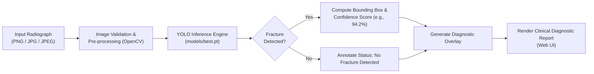

# Bone Fracture AI Detection Platform

[](https://www.python.org/downloads/)
[](https://palletsprojects.com/p/flask/)
[](https://github.com/ultralytics/ultralytics)
[](https://opencv.org/)
[](LICENSE)

An offline, clinical-grade Computer Vision web application utilizing deep convolutional neural networks (**Ultralytics YOLO**) to automatically detect, localize, and annotate bone fractures from extremity X-ray radiographs with high confidence.

---

## 🏥 Clinical Background & Rationale

Traumatic extremity fractures (such as distal radius, carpal, and phalangeal fractures) represent a substantial volume of emergency department visits. Subtle, non-displaced, or hairline fractures can easily be missed or misdiagnosed under high patient loads, resulting in malunion and delayed clinical interventions.

This project was developed in **July 2026** as a dedicated deep learning diagnostic-assist tool designed to run completely offline on hospital edge workstations, providing clinicians with instant secondary reads and visual bounding box annotations.



---

## 🔬 Deep Learning Architecture & Pipeline

1. **Object Detection Engine:**
   - Powered by an optimized **Ultralytics YOLO** architecture fine-tuned specifically on musculoskeletal radiographic datasets.
   - Model weights stored in `models/best.pt`.
   - Performs single-stage detection identifying fracture lines, cortical disruptions, and periosteal elevation.

2. **Image Processing & Annotation Pipeline:**
   - Standardizes radiograph dimensions while preserving aspect ratios using OpenCV (`cv2`).
   - Draws color-coded bounding boxes identifying the exact anatomical locus of the fracture.
   - Computes statistical confidence metrics ($conf \times 100\%$) alongside tentative anatomical localization (e.g., *Distal Radius*).

3. **Inference Web Interface:**
   - Lightweight Flask application providing an intuitive drag-and-drop radiograph upload portal.
   - Side-by-side comparative display comparing raw radiographic exposure against AI-annotated findings.

---

## ⚡ 1-Click Scalable Startup (`start_app.bat`)

To allow clinicians and reviewers to run the model effortlessly without manual command-line intervention, an automated startup script is included:

```
Double-click: start_app.bat
```

### Script Execution Stages:
1. **[STEP 1/4] Runtime Detection:** Checks for Python 3.11 / system Python and builds an isolated `.venv`.
2. **[STEP 2/4] Package Verification:** Installs Flask, OpenCV, NumPy, and Ultralytics from `requirements.txt`.
3. **[STEP 3/4] Weight & Directory Check:** Verifies that `models/best.pt` exists and creates `static/uploads/` and `static/results/`.
4. **[STEP 4/4] Launch:** Opens `http://127.0.0.1:5000` in your default browser and launches the Flask inference server.

---

## 🔒 Privacy & Offline Operation

- **100% Offline Inference:** No cloud services or third-party APIs are contacted. Radiographs never leave the local environment, ensuring compliance with strict healthcare privacy standards (HIPAA/GDPR).
- **Git Hygiene:** Raw patient uploads and temporary result caches in `static/uploads/` and `static/results/` are excluded via `.gitignore`.
- **Zero API Keys Required:** All weights are bundled locally.

---

## 🛠️ Technology Stack

- **Model Framework:** Ultralytics YOLO
- **Computer Vision:** OpenCV (`opencv-python`), NumPy
- **Application Server:** Flask 3.0, Werkzeug, Jinja2
- **Frontend:** Bootstrap, Responsive CSS3
